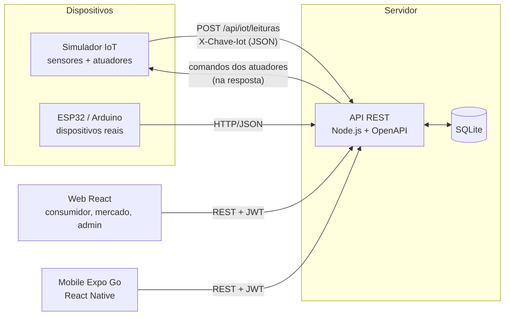
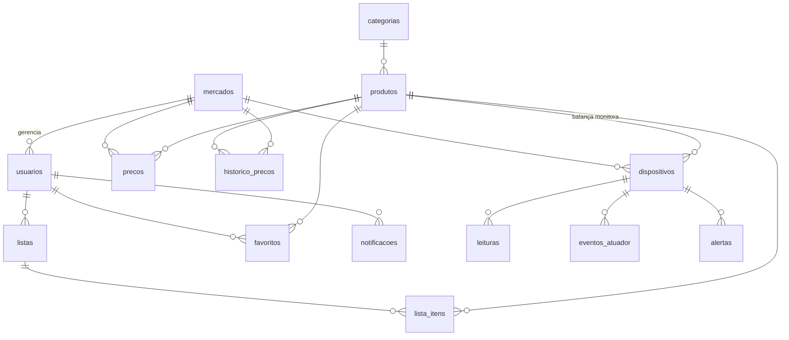

# Arquitetura

## Decisões

- **Node.js puro + SQLite embutido (`node:sqlite`)**: nenhuma instalação de banco, nenhum driver nativo; `npm install` só baixa o front-end. A API usa apenas módulos nativos do Node (servidor HTTP, `crypto`, `fetch`).
- **Rotas como dados**: cada rota é um objeto (método, caminho, perfis, corpo, handler). A mesma tabela alimenta o roteador e a especificação OpenAPI, então a documentação nunca fica desatualizada.
- **Banco compartilhado só pela API**: web e mobile nunca acessam o banco diretamente.
- **Tempo real por *polling* (3 s)**: simples e igual na web e no React Native; o tráfego é pequeno (painel agregado em uma requisição).
- **Atuadores**: o servidor é a autoridade do estado em modo MANUAL; em modo AUTO o próprio dispositivo (termostato) decide e reporta. Os comandos voltam na resposta de cada envio de leituras.
- **Integração IoT × preços**: a balança da gôndola converte peso em unidades (`peso ÷ peso_unitário`) e atualiza `precos.estoque`; a comparação de listas ignora mercados sem estoque.

## Modelo de dados (relacional)

## Principais endpoints

Lista completa e testável em `/api/docs`.

| Grupo | Exemplos |
|---|---|
| Autenticação | `POST /api/auth/login`, `POST /api/auth/registro`, `GET /api/auth/perfil` |
| Catálogo | `GET /api/produtos?q=&categoria=&mercado=&max=&ordem=`, `GET /api/produtos/{id}`, `GET /api/mercados` |
| Comparação | `POST /api/comparar`, `GET /api/listas/{id}/otimizar` |
| Preços (mercado) | `PUT /api/mercados/{id}/precos/{produtoId}` |
| IoT | `POST /api/iot/leituras`, `GET /api/iot/mercados/{id}/painel`, `PUT /api/iot/dispositivos/{id}/atuador` |
| Estatística | `GET /api/estatisticas/dispositivos/{id}`, `GET /api/estatisticas/produtos/{id}`, `GET /api/estatisticas/mercados` |
